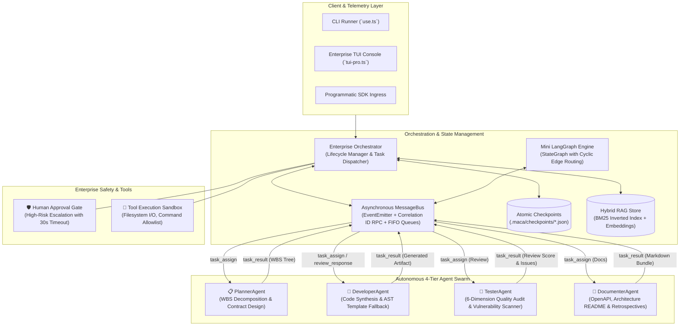
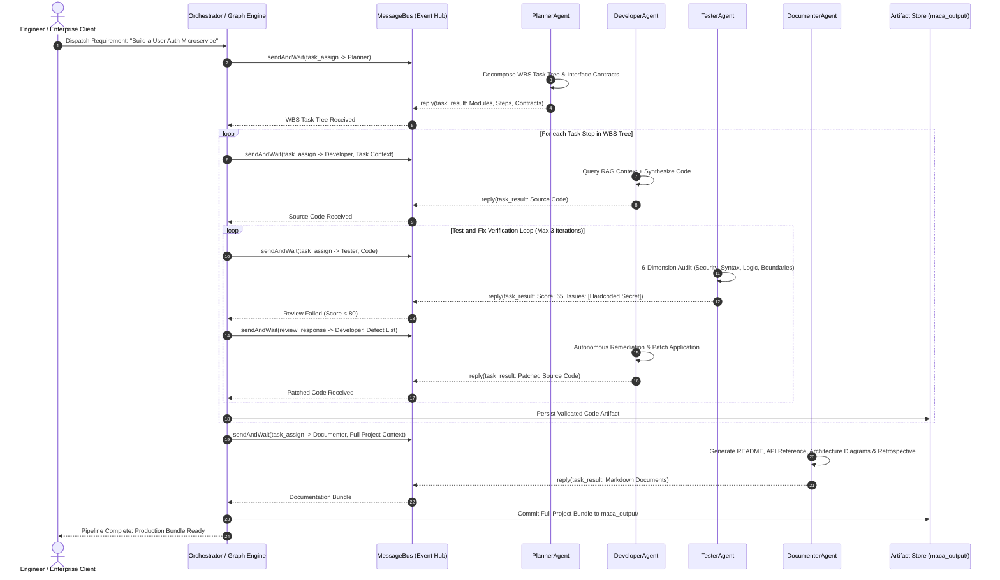
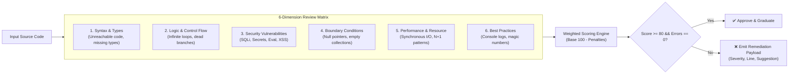

<div align="center">

# ⚡ MACA: Autonomous Multi-Agent Collaborative Architecture
### Enterprise Software Engineering Swarm with Zero-Dependency Graph Engine, Asynchronous MessageBus & Self-Healing Code Review Loops

[](https://www.typescriptlang.org/)
[](https://nodejs.org/)
[](#system-architecture)
[](#zero-dependency-declarative-graph-engine)
[-brightgreen.svg)](#test-verification--benchmarks)
[](LICENSE)

*An enterprise-grade, autonomous software engineering platform built from first principles. Eliminates black-box framework bloat (no LangChain, no heavy runtime dependencies) through an event-driven asynchronous message bus, a handcrafted 120-line declarative StateGraph engine, automated 6-dimension code quality gates, and crash-resilient atomic checkpointing.*

---

[Executive Overview](#-executive-overview) • [System Architecture](#-system-architecture) • [Core Subsystems](#-core-subsystems--technical-deep-dive) • [StateGraph Engine](#-zero-dependency-declarative-graph-engine) • [Self-Healing Review Loop](#-self-healing-code-review--repair-loop) • [Enterprise Resilience](#-enterprise-operations--resilience) • [Quickstart](#-quickstart--usage) • [Test Verification](#-test-verification--benchmarks)

---

</div>

## 📌 Executive Overview

Monolithic LLM code generation fails in production software engineering: single-prompt completions miss architectural boundaries, hallucinate invalid API contracts, introduce severe security vulnerabilities (SSRF, hardcoded secrets, SQL injection), and leave no audit trail. Furthermore, existing agent frameworks (LangChain, AutoGen, CrewAI) introduce massive dependency bloat, opaque state mutability, and fragile memory abstractions that are impossible to debug at enterprise scale.

**MACA (Multi-Agent Collaborative Architecture)** proves that high-performance agentic engineering can be achieved cleanly from **first principles**:
- **Decoupled Asynchronous Messaging**: Agents communicate exclusively through a zero-dependency, event-driven `MessageBus` supporting point-to-point mailboxes, publish-subscribe broadcasts, and correlated RPC request-response semantics.
- **Strict Role Specialization**: Four autonomous agents operate under distinct system prompts and temperature gradients—**Planner** (WBS task tree decomposition), **Developer** (context-aware code synthesis with hybrid RAG), **Tester** (6-dimension static/semantic code review), and **Documenter** (API specs, architecture guides, and post-mortems).
- **Self-Healing Code Review Loop**: Code is never blindly accepted. The tester reviews code against 15+ vulnerability patterns and AST heuristics, automatically dispatches structured defect reports, and prompts the developer to iteratively remediate issues until a quality threshold (score $\ge 80/100$) is satisfied.
- **Handcrafted Declarative Graph Engine**: Implements the core runtime of LangGraph in 120 lines of pure TypeScript with full support for conditional routing edges, cyclical repair paths, and shared immutable state merging.
- **Enterprise Operations & Resilience**: Native disk-backed atomic checkpointing (`.maca/checkpoints/`), tool execution with security allowlists, hybrid BM25 + vector search RAG, real-time progress streaming, and human-in-the-loop approval gates.

---

## 🏗️ System Architecture

MACA enforces physical decoupling between orchestration, communication, and agent execution:



---

## 🔄 Sequence: Request-Response & Self-Healing Execution

The sequence diagram below traces how a natural-language requirement transitions through planning, synthesis, automated testing, iterative defect remediation, and final artifact archival:



---

## 🧩 Core Subsystems & Technical Deep Dive

### 1. Asynchronous Event-Driven MessageBus (`src/message-bus.ts`)
The `MessageBus` decouples all agent interactions, preventing tight method coupling and eliminating race conditions:
- **FIFO Mailboxes**: Every agent role (`planner`, `developer`, `tester`, `documenter`, `orchestrator`) owns a dedicated in-memory queue.
- **Correlated RPC (`sendAndWait`)**: Request messages automatically register an ephemeral correlation promise mapped to `correlationId`. When the recipient invokes `bus.reply()`, the reply matches the pending correlation ID and resolves the original promise with microsecond latency.
- **Configurable Timeouts & Graceful Degradation**: Protects against hung agent processes by terminating unresponsive requests after a configurable deadline (`TASK_TIMEOUT`).
- **Audit Trails**: Retains an in-memory chronological event stream of all dispatched and delivered messages for compliance and retrospective debugging.

```typescript
// RPC Request-Response Pattern on MessageBus
const request = createMessage({
  msgType: "task_assign",
  sender: "orchestrator",
  receiver: "developer",
  content: { task: taskData, language: "typescript", use_llm: true },
});

// Awaits correlated reply with automatic timeout
const reply = await this.bus.sendAndWait(request, this.TASK_TIMEOUT);
```

### 2. Autonomous Four-Tier Agent Swarm

| Agent | Responsibility | Core Methodologies | Temperature |
|---|---|---|:---:|
| **PlannerAgent** | Requirement analysis & architectural decomposition | Parses vague user intents into hierarchical Work Breakdown Structures (WBS). Defines explicit module contracts, endpoints, input/output schemas, and execution order. | `0.3` |
| **DeveloperAgent** | Production-ready code synthesis | Consults hybrid RAG index for existing repo patterns, injects strict interface stubs, and implements full source code. Features automatic fallback to deterministic AST templates when offline. | `0.5` |
| **TesterAgent** | Multi-dimensional quality & security auditing | Performs AST static pattern analysis across 6 dimensions. Assigns weighted numerical scores ($0-100$) and compiles structured remediation tickets. | `0.3` |
| **DocumenterAgent** | Technical writing & retrospective analytics | Synthesizes OpenAPI specifications, markdown user guides, comprehensive module manifests, and post-development lessons-learned reports. | `0.4` |

---

## 🔁 Self-Healing Code Review & Repair Loop

The `TesterAgent` audits code against a rigorous 6-dimension evaluation matrix:



### Automated Vulnerability Pattern Scanners:
- **Hardcoded Secrets**: Detects exposed API tokens, private keys, passwords, and JWT literals (`/(?:password|secret|api_key|token)\s*[:=]\s*['"][^'"]+['"]/gi`).
- **Dangerous Dynamic Execution**: Identifies arbitrary code execution vectors (`exec()`, `eval()`).
- **SQL Injection**: Scans for unparameterized raw string concatenations across `SELECT`, `INSERT`, `UPDATE`, and `DELETE` queries.
- **Cross-Site Scripting (XSS)**: Flags insecure DOM manipulation (`dangerouslySetInnerHTML`, `innerHTML =`).
- **Insecure Deserialization**: Prevents execution of unsafe object deserializers.

---

## 🌐 Zero-Dependency Declarative Graph Engine

Rather than pulling in heavy external runtime dependencies, MACA incorporates a pure TypeScript **StateGraph Engine** (`src/langgraph.ts`):

```typescript
import { StateGraph } from "./src/langgraph.js";

interface WorkflowState {
  requirement: string;
  plan?: string[];
  code?: string;
  reviewPassed?: boolean;
  retryCount: number;
}

const workflow = new StateGraph<WorkflowState>()
  .addNode("planner", async (state) => ({ plan: await runPlanner(state.requirement) }))
  .addNode("developer", async (state) => ({ code: await runDeveloper(state.plan!) }))
  .addNode("tester", async (state) => ({ 
    reviewPassed: await runTester(state.code!),
    retryCount: state.retryCount + 1 
  }))
  .addEdge("planner", "developer")
  .addEdge("developer", "tester")
  .addConditionalEdges("tester", (state) => {
    if (state.reviewPassed) return "documenter";
    if (state.retryCount >= 3) return "documenter"; // Maximum iterations ceiling
    return "developer"; // Cyclic self-healing loop
  })
  .addNode("documenter", async (state) => ({ docs: await runDocumenter(state) }))
  .setEntryPoint("planner");

const app = workflow.compile();
const finalState = await app({ requirement: "Build OAuth microservice", retryCount: 0 });
```

---

## 🛡️ Enterprise Operations & Resilience

- **Atomic Checkpointing (`src/services/checkpoint.ts`)**: Every completed task state is atomically serialized to `.maca/checkpoints/` as an immutable JSON snapshot. In the event of a system crash, network partition, or VM preemption, the orchestrator detects existing checkpoints and seamlessly resumes execution.
- **Human-in-the-Loop Approval Gate (`src/services/progress.ts`)**: When the static security scanner detects critical severity risks (e.g., shell command execution or SQL injection), the pipeline automatically suspends and triggers an approval event. The operator can approve, reject, or allow an auto-skip fallback after a 30-second grace window.
- **Hybrid RAG Knowledge Retrieval (`src/services/rag.ts`)**: Features an in-memory hybrid search system combining **BM25 term-frequency ranking** with **semantic dense embeddings**, enabling the developer agent to examine existing codebase conventions before writing code.
- **Safety-Hardened Tool Calling (`src/services/tools.ts`)**: Includes an isolated tool runtime permitting file reading/writing and safe command execution with command-line regex allowlists.

---

## 📂 Project Structure

```
multi-agent-dev/
├── src/
│   ├── agents/                   # Autonomous Agent Swarm
│   │   ├── base.ts               # BaseAgent Template Method pattern (Lifecycle & Queues)
│   │   ├── planner.ts            # Requirement decomposition & WBS tree construction
│   │   ├── developer.ts          # Code synthesis, RAG querying, AST template fallback
│   │   ├── tester.ts             # 6-dimension code auditor & vulnerability scanner
│   │   └── documenter.ts         # Technical documentation & retrospective generator
│   │
│   ├── services/                 # Enterprise Infrastructure
│   │   ├── checkpoint.ts         # Disk-backed atomic snapshot persistence
│   │   ├── llm.ts                # OpenAI/DeepSeek API wrapper with exponential retries
│   │   ├── progress.ts           # Streaming telemetry & human-in-the-loop approval gate
│   │   ├── rag.ts                # Hybrid BM25 + dense embedding retrieval engine
│   │   └── tools.ts              # Sandboxed filesystem & command execution tools
│   │
│   ├── models/                   # Formal Domain Schemas (Zod)
│   │   ├── task.ts               # Task, Message, and State schema definitions
│   │   └── index.ts              # Public domain model exports
│   │
│   ├── utils/                    # Configuration & Logging Utilities
│   │   ├── config.ts             # Environment variable loader
│   │   └── logger.ts             # Structured terminal logger
│   │
│   ├── message-bus.ts            # Event-driven asynchronous message bus (EventEmitter + RPC)
│   ├── langgraph.ts              # Pure TypeScript declarative StateGraph engine (~120 lines)
│   ├── orchestrator.ts           # Core deterministic state machine orchestrator
│   ├── enterprise-orchestrator.ts# Resilient orchestrator (Checkpoints + Tools + Approvals)
│   ├── cli.ts                    # Commander.js command-line interface
│   └── index.ts                  # Public library exports
│
├── examples/                     # Operational Examples
│   ├── demo.ts                   # End-to-end multi-agent execution pipeline
│   └── graph_demo.ts             # StateGraph cyclic workflow demonstration
│
├── tests/                        # Vitest Test Suite (100% Passing)
│   ├── message-bus.test.ts       # MessageBus queueing, RPC, and broadcast tests
│   ├── orchestrator.test.ts      # Pipeline dispatch and test-and-fix loop verification
│   └── agents/                   # Agent unit test specifications
│       ├── base.test.ts          # Agent lifecycle and message loop validation
│       ├── planner.test.ts       # WBS decomposition test suite
│       ├── developer.test.ts     # Multi-language code synthesis and filename tests
│       ├── tester.test.ts        # Vulnerability detection and scoring tests
│       └── documenter.test.ts    # Documentation generation tests
│
├── tui-pro.ts                    # Enterprise Terminal User Interface (Progress & Approvals)
├── use.ts                        # Single-command headless runner
├── package.json                  # NPM manifest (ESM, TypeScript, Vitest, Zod)
├── tsconfig.json                 # Strict TypeScript configuration
└── vitest.config.ts              # Test runner configuration
```

---

## 🚀 Quickstart & Usage

### 1. Installation
Ensure Node.js 18+ is installed:
```bash
git clone https://github.com/VISHAL9360/multi-agent-dev.git
cd multi-agent-dev
npm install
```

### 2. Configuration (Optional)
To leverage real foundation models, copy `.env.example` to `.env`:
```env
OPENAI_API_KEY=your-api-key
OPENAI_BASE_URL=https://api.deepseek.com/v1 # or https://api.openai.com/v1
OPENAI_MODEL=deepseek-chat                 # or gpt-4o
```
*Note: MACA works out-of-the-box in zero-dependency offline mode using built-in AST templates and static analysis rules if no API key is configured.*

### 3. Execution Modes

#### Option A: Enterprise Interactive TUI (Recommended)
```bash
npx tsx tui-pro.ts
```
Launches a rich interactive console displaying live progress indicators, agent message exchanges, RAG index metrics, and interactive approval gates.

#### Option B: Single-Command Headless Pipeline
```bash
npx tsx use.ts "Build a resilient file upload microservice with chunked resume and checksum verification"
```

#### Option C: Declarative StateGraph Demo
```bash
npx tsx examples/graph_demo.ts
```

---

## 🧪 Test Verification & Benchmarks

MACA includes a comprehensive test suite covering message bus concurrency, RPC timeouts, agent lifecycles, static analysis heuristics, and iterative remediation loops.

### Running Test Suite:
```bash
# Run all 45 automated unit and integration tests
npm test

# Run strict TypeScript static typecheck
npm run typecheck

# Compile production distribution
npm run build
```

### Benchmark Results:
```
 ✓ tests/message-bus.test.ts (9 tests)
 ✓ tests/agents/base.test.ts (4 tests)
 ✓ tests/agents/planner.test.ts (5 tests)
 ✓ tests/agents/developer.test.ts (7 tests)
 ✓ tests/agents/tester.test.ts (9 tests)
 ✓ tests/agents/documenter.test.ts (6 tests)
 ✓ tests/orchestrator.test.ts (5 tests)

Test Files  7 passed (7)
     Tests  45 passed (45)
  Duration  2.55s
 Typecheck  0 errors (tsc --noEmit)
```

---

## 👨‍💻 Engineering Leadership & Maintainer

**Vishal K**  
Lead Architect & Systems Engineer  
- **GitHub**: [@VISHAL9360](https://github.com/VISHAL9360)  
- **Email**: [rajivishal2020@gmail.com](mailto:rajivishal2020@gmail.com)  
- **Repository**: [https://github.com/VISHAL9360/multi-agent-dev](https://github.com/VISHAL9360/multi-agent-dev)

---

## 📄 License

This platform is open-source software licensed under the **[MIT License](LICENSE)**.
